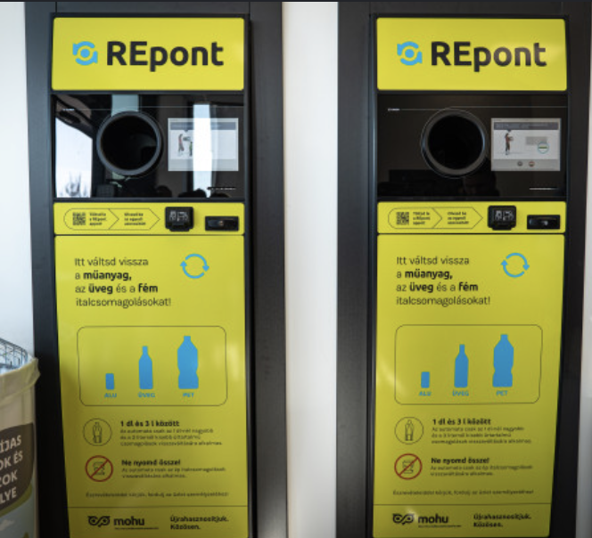

# Bottle Up at Lónyay — Design Brief

Version: 2026-10-29 · Owner: Alex · Repo: [protocsillag/bottle-up-at-lonyay](https://github.com/protocsillag/bottle-up-at-lonyay)

> **For Claude Code:** read this whole file before writing any code. Work through the Build plan one milestone per session, in order. Anything marked as a decision is settled; ask Alex before changing it. Keep `CLAUDE.md` as your running notes.

## Vision and pillars

**Pitch:** You are a street character in Belső-Ferencváros with 48 hours and an empty bag. Dig through bins, slip into stairwells behind closing doors, and feed every bottle and can into the Mohu machine at 50 Ft each. The richest collector makes the wall of fame.

One run is 30 real minutes, which is 48 hours of game time. The game is a 3D, third-person, GTA-style walkable browser game built from scratch in this repo.

- **The real neighbourhood.** Streets, blocks and distances come from map data, so a local recognises Ráday utca, Lónyay utca and Bakáts tér on sight.
- **Laugh with the hero, not at them.** The character is resourceful and stubborn. The jokes come from the city: the grumpy intercom granny, the picky Mohu machine, the házmester, the dog mess.
- **Every bottle is a small decision.** Quick street pickings versus a slow, risky building that may hold a jackpot. The best runs plan a route.
- **Short and replayable.** One 30-minute run, a score, a top 10. Random item, bag and door placement keeps runs different.

## Tech and how to work

A browser game in TypeScript with Three.js and Vite, deployed to GitHub Pages. No engine install, plays from a link on a laptop.

| Area | Choice |
| --- | --- |
| Rendering | Three.js, third-person follow camera, low-poly stylised look |
| Physics and collision | Simple capsule vs. box colliders from building footprints; no physics engine unless needed |
| Map data | OpenStreetMap, pre-baked into `public/data/city.json` by a script in `tools/osm/` |
| State | One `GameState` module: clock, money, bag, character, run status |
| Save | Last character in localStorage; high scores local first (`ScoreStore` interface), moved online to Cloudflare D1 in the last milestone |
| Audio | In `public/audio/`: SFX synthesised in code; Hungarian voice lines generated offline with Piper TTS |
| Controls | Laptop only for now: WASD + mouse look, Shift run, Space jump, E interact (also buys at the shop till), F mount/dismount bike; when tipsy (M10): P pee on a wall, hold E on a public bin to kick it over |

Proposed layout: `src/world/` (city build, doors, bins), `src/player/`, `src/npc/`, `src/minigames/mohu/`, `src/ui/` (HUD, creator, scores), `src/state/`, `tools/osm/`, `server/` (score Worker, last milestone), `reference/` (images from Alex).

Rules for every session:

1. Read this brief and `CLAUDE.md` first. Keep `CLAUDE.md` updated with decisions, controls and file map.
2. One milestone per session (Build plan below). Each milestone ends playable, with `npm run build` passing.
3. Commit at the end of each milestone with a short changelog entry in `CHANGELOG.md`.
4. Keep 60 fps on a mid-range laptop: instanced meshes for repeated windows, bins and trees; merge static geometry per block; cull interiors you are not in.
5. No copyrighted photos, logos or music in the game. The Mohu and REpont look is recreated in flat colours and generic shapes, not the real logo files. Images in `reference/` are for shapes, colours and mood only, never textures.
6. Never use Google Maps or Street View data or images.

## The map: Belső-Ferencváros at real scale

The playable area is Belső-Ferencváros at 1 game metre = 1 real metre, built from OpenStreetMap.

**Boundary:** the Kiskörút (Vámház körút, Kálvin tér) on the north-west, Üllői út on the north-east, Ferenc körút on the south-east, and the Danube embankment on the south-west. Edge streets are walkable but the far side is a facade wall with an invisible barrier. The Danube, Szabadság híd's first span and the far bank are scenery only.

**Data pipeline (`tools/osm/`):**

1. Fetch the area once from the Overpass API: buildings, `building:levels`, `height`, roads, footways, squares, parks, trees, shops and entrances.
2. If the sandbox cannot reach Overpass, ask Alex to export the area from openstreetmap.org and drop the `.osm` file into `tools/osm/raw/`.
3. Convert to local metres and bake `public/data/city.json`. The game never calls OSM at runtime.
4. Missing heights default to 5 storeys at 3.6 m, the typical Pest tenement.

**How it looks:** buildings are extruded footprints with procedural eclectic facades: plaster colours, window grids, a ground-floor shop row, a big wooden gate per house, a roof ledge. Pavements with kerbs, street lamps, trees from OSM, parked cars as static blocks.

**Hand-built landmarks (simplified, recognisable):**

| Landmark | Why it matters |
| --- | --- |
| Központi Vásárcsarnok (Nagycsarnok), Fővám tér | Return point 2: Aldi inside |
| SPAR, corner of Kinizsi utca and Ráday utca | Return point 1 |
| Ráday utca | Busy café street, rich bins, crowds at night |
| Bakáts tér and its church | Open square, bench sleepers, pigeons |
| Iparművészeti Múzeum, Üllői út | Zsolnay roof, tourist crowd |
| Corvinus main building, Fővám tér | Students, bins full of bottles |
| Lónyay utca | The title street; the starting point |
| Kálvin tér | Metro exit crowds, edge of the map |
| Nehru part, Danube bank by Boráros tér | Riverside park full of picnickers: bins and lawns rich in bottles, especially in the evening |

**Alex's own photos come first.** From M11, Alex's photos live in `reference/<location>/`, one folder per street or place, and `reference/README.md` says what each folder shows and what to take from it. Where a photo and the descriptions below disagree, the photo wins.

**Visual references** (descriptions from image searches; the original search screenshots are not in the repo):

| Place | What to capture |
| --- | --- |
| Ráday utca | Narrow street, 3–5 storey cream and ochre tenements, café terraces with red awnings and potted plants down both sides, stone ball bollards, curly street lamps, a small green book kiosk |
| Lónyay utca | Long, straight street of eclectic tenements in ochre, grey and brick red; big wooden gates, corner towers and balconies; the brick Református gimnázium; small trees and planters at the kerb |
| Central Market Hall, outside | Red-brown brick with stone trim, Gothic-revival gable and towers, glazed Zsolnay roof tiles in a diamond pattern, yellow tram passing on the körút |
| Central Market Hall, inside | Huge single hall, orange-brown steel roof trusses, skylights, two levels of stalls with a gallery, paprika strings and busy aisles |
| SPAR, inside | Bright aisles, white floor, red and green signage, fruit and veg up front, self-checkouts; the REpont pair stands by the entrance |
| Nehru part | Wide riverside promenade, metal railing, rows of plane trees, lawn, turquoise and orange concrete loungers, a playground and basketball court, Gellért Hill and Szabadság híd in the distance |

**Scale and speed:** the area is roughly 1.5 km by 1 km. At realistic walking speed (1.4 m/s) crossing it takes about 15 real minutes, half a run. So the character walks at 2.5 m/s, runs at 5 m/s with a stamina bar, and a bike does about 8 m/s. Crossing at a run is then around 3 to 5 real minutes, which keeps the two return points a real route decision.

## Game flow and core loop

1. **Title screen:** Play, High scores, Settings (volume, mouse sensitivity, graphics quality).
2. **Character creator:** pick a preset, customise, type a name (max 16 characters). A portrait is captured for the score table.
3. **Intro card:** "Friday, 08:00. Lónyay utca. 48 hours. Every bottle and can is 50 Ft." The player spawns with an empty bag.
4. **The run:** collect, carry, return, repeat until the clock hits Sunday 08:00.
5. **End screen:** money earned, items returned, items still in the bag (worth nothing), funniest stat (doors slammed, dog incidents, házmester catches).
6. **High scores:** if the total is in the top 10, the entry is saved with name, portrait and amount.

**Time:** 30 real minutes = 48 game hours, so 1 real minute = 1 hour 36 minutes of game time. A full day-night cycle lasts 15 real minutes.

**Countdown (M10).** The end of the run must always be obvious. The HUD shows a countdown next to the clock, in real time, e.g. "Ends in 23:41", with the game time left underneath ("Sunday 08:00 · 37 h left"). At 5 real minutes left it turns orange and a toast says "5 minutes left — empty your bags!"; in the last 60 seconds it turns red, pulses and ticks audibly. The intro card states the end time too.

**Money only counts at the machine.** Items in the bag are worth 0 Ft until they go through a Mohu machine. A full bag at closing time is a race to the counter.

**Bags (changed in M10).** Every bag holds 50 items (plastic bottles, cans and glass count the same). The character starts with one bag and can carry at most 3, so 150 items. Extra bags are hidden around the area, about 4 per run, mostly in courtyards (about 1 in 3 of them on the street, e.g. behind the Nehru part kiosks or the Ráday book kiosk). The old single 100-item IKEA-style bag is replaced by these; the extra bags keep its look (generic blue woven bag with yellow handles, no logo). A 4th bag found while carrying 3 shows "Can't carry more bags". The character model shows one, two or three bags in hand and on the shoulder. At the limit the prompt changes to "Bags full — go to a Mohu machine".

**Score ceiling: 50 000 Ft (1 000 items).** The world spawns about 1 400 items across the run, so a near-perfect route with extra bags found early can approach 50 000 Ft. A strong run lands around 25 000–35 000 Ft, a first run around 10 000 Ft. From M10 the score is the money left at the end, after food and beer.

**HUD:** countdown and game clock, money in Ft, items carried / capacity with the number of bags (e.g. "73 / 100 · 2 bags"), stamina, hunger (M10), a small north-up minimap with the two return points, status icons (slowed, on bike, hungry, tipsy).

**Shop hours.** Both return points are open 06:00–24:00 every day of the run, Sunday included. Between midnight and 06:00 the doors are shut, so a full bag at 23:50 is a sprint, and the night is for filling up and waiting for the morning.

## Character creator

The run starts here: pick one of four presets, swap pieces, name the character. The model rotates on a turntable while the player edits. All pieces are low-poly meshes built in code, so each is a few lines to add.

| Preset | Look | Default name idea |
| --- | --- | --- |
| The Punk | Green mohawk, leather jacket with studs, ripped jeans, boots | Tüske |
| The Old Timer | Grey beard, flat cap, tweed jacket, plastic sandals with socks | Feri bácsi |
| The Hobo Romantic | Long coat, scarf, fingerless gloves, beanie | Bandi |
| The Festival Survivor | Bucket hat, faded band-style T-shirt with an invented band, cargo shorts | Csabi |

**Customise slots (4–6 options each):** hat, top, bottoms, shoes, accessory (sunglasses, earring, chain, backpack, dog on a string as a cosmetic), and colour swatches for hair and the main garment.

**Name:** free text, 1–16 characters, Hungarian accents allowed, a short blocklist for slurs.

**Portrait:** on confirm, render the head and shoulders against a yellow Mohu-style background into a 128 × 128 PNG and keep it with the run. This is the picture on the high-score table.

Accessories are cosmetic only in the first version. Stretch idea: a headlamp that shows items in bins at night.

## Bottle sources and getting into buildings

Plastic bottles, aluminium cans and glass bottles all count, each worth 50 Ft at the machine. Glass sometimes breaks when you run with a full bag (lose one, with a clink).

| Source | Items | Time to take | Refills | Notes |
| --- | --- | --- | --- | --- |
| Street item | 1–2 | Instant (E) | Several new ones every game hour | Benches, tram stops, café fronts, kerbs |
| Hidden spot | 2–6 | Instant (E) | Once per game day | Behind planters, under benches, in bushes at Nehru part, behind the Ráday book kiosk; a faint glint only up close |
| Public bin | 2–8 | Hold E for 2 s | 6 game hours after searching | Fuller near Ráday utca at night, Corvinus on weekdays, Nehru part in the evening |
| Party leftovers | 15–30 | Hold E for 3 s | A few per night, 22:00–04:00 | Crates and heaps of cans outside Ráday bars and on the Nehru part lawn |
| Courtyard bins inside a building | 5–20 per bin, 1–3 bins | Hold E for 4 s per bin | 12 game hours | The main source of volume |
| Jackpot courtyard | 40–80 | Hold E for 6 s | Once per run each | 3–4 random buildings per run: a renovation skip full of cans, a party flat's recycling. Often guarded by a házmester |

**Entering a building.** Every residential block on the map gets a street gate (from OSM entrances where present, otherwise one per facade). The player can enter two ways:

1. **Wait for a resident.** Each gate has a resident leave at a random moment, roughly every 30–90 real seconds, more often at 07:00–09:00 and 17:00–19:00, rarely after midnight. The resident walks out and the heavy gate swings shut over about 4 seconds. Get through before it clicks.
2. **Ring the bell.** E at the intercom panel. 1 in 10 rings buzzes the door open. The other 9 play a voice line from a grumpy old lady (or occasionally an old man) and the door stays shut. A short cooldown stops bell spam.

**Intercom lines (Hungarian audio, English subtitles), drawn randomly, never twice in a row:**

- "Nem kérünk semmit!" — We don't want anything!
- "Reklámot a postaládába!" — Ads go in the mailbox!
- "Menjen innen, mert hívom a rendőrséget!" — Go away or I'm calling the police!
- "Ki az? Nem várok senkit." — Who is it? I'm not expecting anyone.
- "A Józsi nincs itthon!" — Józsi isn't home!
- "Megint a gázórás? Múlt héten volt itt!" — The gas man again? He was here last week!
- "Fiatalember, éjjel kettő van!" — Young man, it's two in the morning! (night only)
- "Tanúi vagyunk, köszönjük!" — We're Witnesses already, thank you!
- "Hallóóó? ... Hallóóó?" — Hellooo? (then silence)

**Voice lines are generated, not recorded.** Install Piper TTS locally, synthesise every Hungarian line with a Hungarian voice, pitch and slow it for the old lady, add a crackly intercom filter, and commit the MP3s to `public/audio/voice/`. Check each voice's licence; the Anna voice is personal and non-commercial, which fits this free hobby game. Fallback if Piper fails: the browser's speech engine with a `hu-HU` voice. Until audio exists, show subtitles only.

**Inside:** one reusable Pest courtyard template, scaled to the building's footprint: gateway passage, mailboxes, courtyard with the bin corner, a staircase, open corridors (gang) on each floor. Upper floors are scenery in v1. The player leaves through the same gate, which opens freely from the inside.

**The házmester (caretaker).** About one building in four has one: a stocky man in a grey work coat and slippers, broom in hand, patrolling the courtyard on a loop.

- He spots you within about 8 metres in his view cone, or if you search a bin noisily nearby.
- He shouts ("Hé! Maga meg mit keres itt?!" — Hey! What are you doing here?!) and gives chase at walking speed.
- You have 5 seconds to get out through the gate. If he catches you, he takes half the bag (rounded down) and marches you out.
- At night he is asleep 70% of the time; you hear him snoring through a window.

## Mohu machine mini-game

At either return point the player walks up to a pair of REpont machines and presses E. The camera cuts to a close-up and the bag empties into the machine. Most items go in automatically at about 3 per second; the player only acts when the machine rejects one. A full load of 3 bags (150 items) takes about a minute including rejects, which keeps a 1 000-item run possible.

**Look:** recreate the machine from the photo in flat shapes: black upper body with the round opening and a small screen, yellow front panel with the ALU / ÜVEG / PET icons, the "1 dl és 3 l között" and "Ne nyomd össze!" panels as generic text, and a printer slot. No real logo files; a lookalike wordmark in the game's font is fine.

**How it plays:**

1. Hold Space to feed: items fly from the bag into the round opening one after another, each with a scan beep and +50 Ft ticking up on the screen.
2. About 1 in 8 items is rejected (red screen, the item slides back out) and feeding pauses.
3. Fix the reject with a small action (below), then rotate it with A / D until the ring around the opening turns green and press Space to push it in.
4. Release Space anytime to stop and walk away with what is left in the bag.

**Why an item gets rejected, and what you can do:**

| Screen message | Cause | Fix |
| --- | --- | --- |
| Ne nyomd össze! | Item is crushed | Mash E to pop it back into shape, then retry |
| Nem olvasható vonalkód | Label is wet or twisted | Hold E to wipe and straighten it, then retry |
| Próbálja újra | Machine hiccup | Just retry; sometimes it happens three times in a row |
| Nem visszaváltható termék | No deposit label | Lost: it goes in the bin next to the machine |

Each item's condition (fine, crushed, wet, no deposit) is rolled when it is picked up. Bin items are more often crushed, street items more often wet.

**The queue.** When you arrive, each return point rolls 0, 1 or 2 people already at the machines (about 50 / 35 / 15 %). They are pensioners with a trolley, a student with a crate of cans, or a fellow street collector with a giant sack. Each takes 10–30 real seconds; you wait in line behind them, or walk to the other shop. Rarely one of the two machines shows "Megtelt" (full) and only the other works.

**Payout:** when the bag is empty, the printer spits out a receipt and the money goes straight into the HUD total.

## Time, NPCs, hazards and bikes

**Day and night.** The sun moves with the game clock; street lamps and shop windows switch on at dusk. Night is darker but not black: items get a faint glint so they stay findable.

| Time | Street life | Effect on items |
| --- | --- | --- |
| 07:00–10:00 | Commuters, gates open often | Good time to slip into buildings |
| 10:00–18:00 | Shoppers at the market hall, students at Corvinus, tourists | Steady bin refills |
| 18:00–02:00 | Ráday utca crowds outside bars, picnickers at Nehru part | Most street items and party leftovers appear |
| 02:00–07:00 | Nearly empty, a street sweeper truck | Sweeper clears street items on its route; gates almost never open |

**NPCs.** Pedestrians walk the pavements on paths baked from OSM footways, with simple avoidance. Types: commuter, tourist with a phone, student, pensioner with a shopping trolley, dog walker, bar crowd, and fellow street people pushing trolleys or sitting on benches. Street people are atmosphere only, not rivals: they never take items, but one may nod or say "Szia, haver" as you pass. Density follows the table above, capped at about 60 visible. NPCs occasionally finish a drink and drop the bottle.

**Dog mess.** Dog walkers leave piles on the pavement, plus a few fixed ones per run. Stepping in one slows the player to 70% speed for 1 real minute, leaves brown footprints, and plays a sound. Bikes ride over them safely.

**Bikes.** 6–10 unlocked bikes are scattered at random each run, leaning on railings or lamp posts. F to mount, F to dismount. Riding is about 8 m/s, no running, no bin searching while mounted. Crash into a pedestrian or wall and you fall off and lose a few seconds. A bike left behind stays where you dropped it.

**No death.** Nothing kills the player, cars included. The only fail state is running out of time with items still in the bag.

## Hunger, beer and traffic (M10)

**Shop till.** Inside SPAR and the Aldi corner of the market hall there is a till. E at the till opens a small menu; prices come out of your money at once. If you can't afford it, the cashier says "Nincs elég pénze, kérem." (You don't have enough money.)

| Item | Price | Effect |
| --- | --- | --- |
| Food: bread roll with párizsi | 100 Ft | Fills the hunger bar completely |
| Beer, a.k.a. "folyékony kenyér" (liquid bread) | 200 Ft | Tipsy for 2–6 game hours |

**Hunger.** A hunger bar sits under stamina and starts full. A full bar lasts about 14 game hours (about 9 real minutes), so a player gets hungry roughly 3 times in a run. At 25% the HUD warns "Getting hungry"; you can eat any time to top up, so smart players eat before the shops close at midnight. When the bar is empty:

- The character walks at 60% speed and cannot run.
- No picking up, searching bins or courtyards; the prompt says "Too hungry — buy food at SPAR or Aldi".
- Feeding a Mohu machine and buying food still work, since both are in the shops.
- Hungry at night with the shops shut means a slow crawl until 06:00. That is the intended lesson.

**Beer and being tipsy.** One beer makes the character tipsy for a random 2–6 game hours (about 1.25–3.75 real minutes). Another beer while tipsy restarts the timer and makes the wobble stronger. While tipsy:

- Walking and running are 20% faster.
- The world sways: a gentle camera roll and bob, a slight drift in steering, a soft blur at the screen edges. Keep it mild enough to stay playable and turn it down with the graphics quality setting.
- **Pee on buildings:** press P next to a wall for a 3-second animation, a puddle decal that fades after a minute and a relieved sigh. A pedestrian within 10 m says something like "Nem szégyelli magát?!" (Have you no shame?!). Inside a courtyard, a házmester who sees it starts a chase. Counts toward the end-screen stats ("walls watered").
- **Smash trash cans:** hold E for 1 s on a public bin to kick it over. All its items spill at once, faster than a normal 2 s search, but the bin stays broken and never refills that run. Counts toward the end-screen stats ("bins kicked").
- Shown as a beer-mug status icon with the time left.

**Traffic.** Cars drive the OSM roads; pedestrian streets and the pedestrian part of Ráday utca stay car-free. About 15–30 cars near the player at once, at roughly 30 km/h (8 m/s), following one-way rules from OSM and slowing at junctions. Parked cars stay as they are. Cars honk and slow down when you stand in the road ahead of them, but cannot stop in time if you step out close in front.

- **Hit by a car:** the character is knocked down for 2 s, loses 1–5 items (they shatter or roll away and are gone), and the driver shouts something like "Nem látsz, haver?!" (Are you blind, mate?!). On a bike you also fall off. No other damage.
- Cars are instanced simple low-poly models in common colours, with headlights at night.
- A yellow tram on the körút edge (Vámház körút, Ferenc körút) may be added as moving scenery; it cannot be entered and hits like a car.

## The fire barrel fight (M13)

A once-per-run gamble: win a street fight and double what you are carrying, lose it and lose your haul.

**Where and when.**

- A group of 4 street people stands around a rusty barrel bin with a fire burning in it, on the Nehru part, at the point nearest to where Kinizsi utca reaches the riverside. Find the spot from `city.json` (the Kinizsi utca way's end nearest the river, projected onto the Nehru part zone) and keep it on open ground, not on a path.
- **They only exist while the player is tipsy.** When tipsy starts, the group and the fire spawn; when tipsy ends, they are gone (fade out if the player is not looking, otherwise they "walk off" toward the river). At night the fire glow and a column of smoke are visible from about 150 m; the minimap shows no marker, so finding them is the reward for drinking.
- Fire: flickering flame sprites in the barrel, an orange point light (reuse one of the pooled lamp lights, so the light count does not change), sparks, smoke, a crackle sound that fades with distance. The group warm their hands, pass a bottle, sway, laugh.
- Once the fight has happened in a run (win, lose or draw), the group still appears when tipsy but only chats; no second fight.

**Talking to them.** E on any of them opens a short dialogue with the leader, **Zsiga, a Bajnok** (Zsiga the Champion): a big man in an olive army parka, a black beanie, fingerless gloves and a scarred nose. Hungarian lines with English subtitles, e.g.:

- "Na, haver! Látom, jól megy a gyűjtés." (Well, mate! Collecting's going well, I see.)
- "Egy menet. Ha nyersz, duplázom a zsákmányodat. Ha veszítesz, az enyém minden, ami nálad van." (One round. Win and I double your haul. Lose and everything you carry is mine.)
- Choice: **1 "Benne vagyok!"** (I'm in!) or **2 "Majd máskor."** (Another time.)
- The choice panel also states the stakes in English with the real numbers, e.g. "Now: 20 items · Win: 40 · Lose: 0".
- If the player carries nothing: "Üres zsákkal nem bunyózunk." (We don't fight over an empty bag.) No fight offered until they carry at least 1 item.
- Walking away and coming back later (still tipsy) offers the fight again, until it has been fought once.

**The stakes.**

- **Win:** items carried become `min(items × 2, capacity)`, where capacity is bags × 50. Examples: 1 bag with 20 → 40; 1 bag with 40 → 50; 3 bags with 90 → 150. New items are fine-condition cans and PET bottles in a random mix.
- **Lose:** every item in every bag is gone (Zsiga's friends tip the bags into their shopping trolley). The bags themselves stay with the player.
- **Draw:** nothing changes. A draw is a double KO, or the 3-minute timer running out before anyone is knocked out.
- Money already earned is never at stake.

**The fight itself: a 2D side-view brawler in the style of classic arcade fighting games.** It is entirely original: no characters, sprites, sounds, fonts, names or logos from any existing game.

- It replaces the 3D view with a full-screen 2D canvas (keep the 3D scene loaded but stop rendering it). Background: Nehru part at night, painted in layers: the river and the lit green Szabadság híd behind, plane trees, the fire barrel at the side, and the other three street people at the back cheering and swaying (simple 2–3 frame loops).
- **Fighters:** the player's own character, drawn in 2D from the creator look (preset, hat, hair, top, bottoms, shoes and colours, as layered shapes), and Zsiga. Draw both as procedural shapes or code-generated sprite frames, around 40% of screen height, with animation frames for idle, walk, jump, crouch, punch, kick, special, block, hit and KO.
- **HUD:** a health bar for each at the top (player left, Zsiga right) with names under them, and a **3:00 countdown in the middle** in real seconds. "HARC!" (FIGHT!) at the start, "K.O." or "DÖNTETLEN" (DRAW) at the end.
- **Laptop controls:** A / D walk, W jump, S crouch, J punch, K kick, J + K together = special. Holding the direction away from the opponent blocks.

| Move | Damage | Notes |
| --- | --- | --- |
| Punch | 6 | Fast, short reach |
| Kick | 9 | Slower, longer reach; low kick while crouching |
| Jump kick | 12 | Only in the air |
| Special: bag swing ("Zsákos csapás") | 18 | Player only. 0.6 s wind-up, knocks the opponent down; usable once every 10 s |
| Zsiga's special: belly punch ("Gyomros") | 16 | Short charge with a tell (he pulls his arm back and grunts) |
| Blocked hit | 1 | Chip damage only |

- Health 100 each. Hit stun, knockback, a knockdown on specials, a short invulnerability when getting up. Comic, no blood: stars and a tweeting bird on KO, dust puffs, cans flying out of the background crowd.
- **Zsiga's AI** should be beatable on the first try about half the time: he walks in, mixes punches and kicks, blocks about 30% of attacks he can see coming, uses his special every 8–12 s, and reacts in 350–500 ms. Put all fight numbers in `balance.ts`.
- **Being tipsy shows in the fight:** the background and the player sway slightly (stronger at higher tipsy levels), and the player's punches do +1 damage per tipsy level. Keep it fair.
- Sounds synthesised like the rest: thuds, whooshes, grunts, a crowd cheering, the fire crackling.

**Time stops during the fight.** From the moment the fight screen opens until the result card closes, the game clock, the end-of-run countdown, the tipsy timer, hunger, traffic, NPCs and all world timers are paused, exactly like the Esc pause. Esc during the fight pauses the fight itself.

**After the fight.** A result card with the numbers ("40 items → 80", or "Elvitték a zsákmányt" — they took the haul), Zsiga's line ("Szép volt, haver!" — Nice one, mate! / "Holnap is itt leszek." — I'll be here tomorrow too), then back to the 3D view next to the barrel. The end screen gets a stat for it ("Beat Zsiga the Champion" / "Lost to Zsiga"). The fight is once per run; the flag lives in `GameState`.

## Phones (M14)

Make the whole game playable in phone browsers, the same way as in Kiruna: The Game (`protocsillag/kiruna-the-game`, see `src/ui/touch.ts`, its CSS and the "Mobile" note in its `CLAUDE.md`). Desktop must stay exactly as it is.

**Detection.** `matchMedia('(hover: none) and (pointer: coarse)')` sets `body.touch`; all touch UI is hidden otherwise. A laptop with a touchscreen stays a desktop.

**Quality.** Phones start on **Medium** quality (the existing Medium preset: pixel ratio ≤ 1.5, 1024 shadow map, 45 NPCs). A quality setting the player saved still wins. If the frame rate stays under 25 fps for 10 seconds, show a toast once suggesting Low quality, with a button that switches it.

**Screen.** Landscape is the main target and gets the careful layout. Portrait is allowed too, as in Kiruna: the game runs and stays playable (nothing cut off or overlapping, controls reachable), but it doesn't need its own polish. No rotate-your-phone block. Respect safe areas (`env(safe-area-inset-*)`) for the notch and home bar, `touch-action: none`, no text selection, no double-tap zoom, no pull-to-refresh. Android: go fullscreen on the first tap. iPhone has no pointer lock; guard every pointer-lock call. Start audio and speech on the first touch.

**Controls on the street.**

- **Left thumb:** a floating joystick wherever the thumb lands on the left 45% of the screen; analog walking, and steering on a bike.
- **Right thumb:** drag to look; pinch to zoom.
- **Interaction:** the prompt itself is a big button above the right thumb. Tap for press actions; press and hold for the hold actions (bins, courtyards, kicking a bin over).
- Buttons on the right: **Run** (toggle, like Kiruna's Jog), **Jump**, **Bike** (shows only when a bike is in reach or you are riding), **Pee** (only while tipsy and facing a wall). Top bar: **❚❚** pause, **Map** (large map), and the countdown stays visible.
- Till: the two items become tappable buttons ("Food 100 Ft", "Beer 200 Ft") and a Close button.
- Intercom choice and the fight offer: tappable answer buttons.

**Controls in the mini-games.**

- **Mohu machine:** a big hold-to-feed button; when an item is rejected, a Fix button (tap repeatedly for crushed, hold for wet), ◀ ▶ buttons to turn it, a Push button and a Walk away button.
- **Fight (M13):** the left joystick moves (up = jump, down = crouch, away from the opponent = block); Punch, Kick and Special buttons on the right in an arc.

**Menus.** Title, character creator (tap the slot arrows, swipe the turntable to rotate, the native keyboard for the name), intro card, pause card, settings, end screen and top 10 all fit a phone in landscape (about 844 × 390 CSS px) without scrolling, with tap targets of at least 44 px.

**HUD layout.** Compact on phones: countdown and clock top centre, money and bags top left under the pause/map buttons, stamina and hunger as thin bars under them, a smaller minimap top right, toasts and subtitles above the joystick area so thumbs don't cover them.

**Testing.** Without a real phone in the sandbox, test with Playwright's device emulation (iPhone 14 and Pixel 7 in landscape, `hasTouch: true`), driving touch events through a full run: title → creator → walk → pick up → bin → gate → courtyard → shop till → Mohu machine → beer → fight → end screen → top 10. Write in `CLAUDE.md` what still needs a real phone to check.

## High scores

The top 10 table shows rank, portrait (128 × 128), name and amount in Ft, sorted by amount, ties broken by earlier date. A run that makes the top 10 lands on the table straight from the end screen with its row highlighted. Format amounts the Hungarian way: `12 350 Ft`.

**Two steps.** Milestone 7 builds the top 10 in localStorage behind a `ScoreStore` interface, so the game is complete on one laptop. The shared online board comes last, in milestone 12.

**Online backend (milestone 12): a Cloudflare Worker with a D1 database, on the free plan.** Free, no credit card, never pauses, and a top 10 board uses a tiny fraction of the daily limits.

- Table `scores`: id, name, amount_ft, items, portrait (128 × 128 PNG as base64, under 20 KB), created_at.
- `GET /scores` returns the top 10. `POST /scores` adds a run and returns its rank.
- GitHub Pages hosts the game; the game calls the Worker.
- Light anti-cheat: reject amounts above 50 000 Ft, names over 16 characters and portraits over 20 KB; allow 1 post per minute per IP.
- If the Worker is unreachable, save locally and show "offline" on the table.
- Alex creates a free Cloudflare account and runs `npx wrangler login` when asked; Claude Code writes the Worker in `server/`, creates the D1 database and deploys it.

## Build plan

Fourteen milestones, each ending in something Alex can open and play. M1–M12 are built. M10 and M11 were added after Alex's first playtest, before the shared high scores; M13 and M14 were added once the game was complete. M3 is the first real playtest: if collecting and returning is not fun with grey boxes, fix that before adding polish.

1. **M1 Setup and city.** Vite + TypeScript + Three.js scaffold, `CLAUDE.md`, GitHub Pages deploy. OSM import script, baked `city.json`, extruded grey buildings, streets, the map boundary. A capsule you can walk around at real scale.
2. **M2 Player and camera.** Third-person character with walk, run, jump, stamina, collisions against buildings, follow camera, minimap.
3. **M3 Core loop in grey boxes.** Game clock (30 min = 48 h), street items (bottles, cans, glass), hidden spots, public bins, party leftovers, the 40-item bag and the hidden 100-item IKEA-style bag, shop hours 06:00–24:00, HUD, a placeholder machine at both return points that accepts everything, end screen. First playtest.
4. **M4 Buildings.** Gates, random resident exits with the slow-closing door, the bell with 1-in-10 odds and subtitled lines, the courtyard interior template, courtyard bins, jackpot courtyards, the házmester and his chase.
5. **M5 Mohu mini-game.** The machine model, close-up camera, hold-to-feed at 3 items per second, rejection reasons and fixes, the 0–2 person queue, "Megtelt", receipt.
6. **M6 Living city.** NPC pedestrians with time-of-day density, including street-people NPCs, day-night lighting, street lamps, dog mess and the slow effect, bikes, street sweeper.
7. **M7 Character creator and local scores.** Four presets, accessory slots, name, portrait capture, the top 10 screen with scores saved locally behind `ScoreStore`.
8. **M8 Looking like Budapest.** Procedural tenement facades, the hand-built landmarks, SPAR and the market hall entrance and interiors, Nehru part, trees and lamps, colour pass from `reference/`.
9. **M9 Polish.** Synthesised SFX and Piper-generated Hungarian voice lines, title screen, settings, performance pass, balance pass (ceiling about 50 000 Ft, strong run 25 000–35 000 Ft), playtest with friends.
10. **M10 Gameplay round 2.** Bags of 50, up to 3 carried, about 4 extra bags hidden per run (mostly courtyards) replacing the 100-item bag; the countdown and its warnings; the shop till with food (100 Ft) and beer (200 Ft); the hunger bar and its penalties; being tipsy (speed, sway, peeing, kicking bins over); moving car traffic and the hit penalty (lose 1–5 items); new HUD items and end-screen stats; rebalance so the 50 000 Ft ceiling and the strong-run range still hold with spending. See "Bags", "Countdown" and "Hunger, beer and traffic".
11. **M11 Real streets from Alex's photos.** Go through `reference/README.md` and each `reference/<location>/` folder and rework that place to match the photos: building types and colours, ground floors, gates and gateways, street furniture, parking, planters, signs and pavement materials. Start with Lónyay utca, then each location in the order listed. Alex adds folders over time, so do whatever is there when the session starts and list in `CLAUDE.md` which folders are done. Cap each location at about an hour of work.
12. **M12 Shared high scores.** Cloudflare Worker + D1 in `server/`, anti-cheat checks, swap the local `ScoreStore` for the online one, keep local as the offline fallback, move existing local scores up.
13. **M13 The fire barrel fight.** The street-people group around a burning barrel on the Nehru part at the end of Kinizsi utca, only while tipsy; the dialogue with Zsiga and the stakes; the 2D one-round fight with health bars and a 3-minute timer; the world paused during it; the result applied to the bags; once per run. See "The fire barrel fight".
14. **M14 Phones.** Touch controls for the street, the till, the Mohu machine and the fight; phone layouts for the HUD and every menu, designed for landscape and still usable in portrait; Medium quality by default; Playwright device-emulation testing. Desktop unchanged. See "Phones".

**Unattended overnight run (M13 + M14).** Alex will start both in one session and sleep. Do M13 first, then M14, each ending with `npm run build` passing, a `CHANGELOG.md` entry, `CLAUDE.md` updated, a commit and a push to `main`. Don't stop to ask; make the most reasonable choice and add it to "Questions for Alex" in `CLAUDE.md`. If M13 runs long, finish it properly before starting M14 rather than leaving both half done.

Risks: M1, because patchy OSM data or a heavy scene hurts everything later; and M8, where "recognisable" can eat unlimited time, so cap each landmark at about an hour of work.

## Decisions

Settled by Alex:

- 3D third-person, GTA-style, walkable Belső-Ferencváros at realistic distances, in the browser, on laptops and (from M14) phones.
- English UI with Hungarian words and voice lines; audio is generated, not recorded.
- Character creator with presets, accessories and a name before every run.
- Plastic bottles, cans and glass all count, 50 Ft each, paid only at the machine.
- Each bag holds 50 items; carry up to 3; extra bags are hidden, mostly in courtyards. Score ceiling about 50 000 Ft.
- A clear countdown to the end of the run.
- Hunger: about 3 times per run; food is 100 Ft at SPAR or Aldi; hungry means slow and unable to collect.
- Beer is 200 Ft and makes you tipsy for 2–6 game hours: faster, a swaying world, peeing on buildings, kicking bins over.
- Moving cars; a hit costs 1–5 items.
- Alex's own photos per location in `reference/<location>/` set the look of each place.
- Items from streets, hidden spots, bins, party leftovers and building courtyards; doors by waiting for a resident or ringing (1 in 10 opens).
- A házmester guards some courtyards.
- Return points: SPAR at Kinizsi and Ráday utca, Aldi in the Central Market Hall at Fővám tér, both open 06:00–24:00, each with 0–2 people queuing at random.
- 48 game hours in 30 real minutes, then a top 10 with name, portrait and amount: local first, shared online (Cloudflare Worker + D1, free) as the very last milestone.
- Dog mess slows for a minute; bikes make you faster; NPCs fill the streets, including street people; no rivals.
- M13: while tipsy, a group around a burning bin on the Nehru part near the end of Kinizsi utca offers one fight per run. Win doubles the items you carry (up to your capacity), lose loses them, a draw changes nothing. 2D side-view fight, one round, health bars, a 3-minute timer; the game clock and countdown are paused while it lasts.
- M14: playable in phone browsers like the Kiruna game; phones start on Medium quality.

Defaults (change only if Alex asks):

- Three.js on GitHub Pages; WASD and mouse.
- Walk 2.5 m/s, run 5 m/s, bike 8 m/s.
- The run starts Friday 08:00 at Lónyay utca.
- Item condition (crushed, wet, no deposit) drives machine rejections; glass can break when running.
- About 1 400 items spawn per run; the machine auto-feeds so the player only handles rejects.

Before you start, check with Alex that these exist:

- [x] `reference/mohu-repont-machines.png`.
- [ ] Alex's location photos in `reference/<location>/` (first: `lonyay-utca/`; more coming), described in `reference/README.md`.
- [ ] A free Cloudflare account (needed only for M12).
